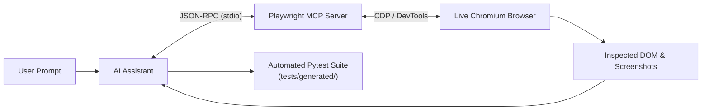

# How We Used Playwright's Model Context Protocol (MCP)

This document provides a comprehensive technical walkthrough of how the **Playwright Model Context Protocol (MCP) Server** was designed, integrated, and used in this project to transition from manual, error-prone test authoring to an **autonomous, interactive AI testing workflow**.

---

## 1. Executive Summary & Paradigm Shift

### The Traditional Problem
Automating end-to-end tests typically follows a frustrating cycle:
1. Developers inspect page elements using browser DevTools.
2. Complex CMS frameworks (like Tilda, Webflow, React SPAs) generate dynamic hashes, nested divs, and hidden overlay submenus.
3. Developers write test selectors based on static guesses.
4. Tests fail on execution due to timing issues, hidden elements, or Playwright **strict mode violations** (multiple matching elements).
5. Fixing selectors requires repeated test reruns.

### The MCP Solution
By connecting Playwright as an **MCP Server** directly to the AI assistant:
* The AI agent **drives a real, live browser session interactively** during conversation.
* The agent explores the live DOM, clicks buttons, opens menus, and inspects computed attributes before writing a single line of test code.
* Once the exact behavior and locators are validated, the agent writes **deterministic, pre-verified `pytest-playwright` tests** that pass on the very first run.



---

## 2. Architecture: Pure Python MCP Implementation

While Microsoft publishes a pre-packaged Node.js MCP server (`@playwright/mcp`), our project required a **100% Python stack** without creating `package.json` or introducing npm dependencies into the repository.

### Server Implementation ([playwright_mcp.py](file:///d:/playwright/playwright_mcp.py))
Using the official Python `mcp` SDK (`FastMCP`) and `playwright.async_api`, we created a standalone, asynchronous MCP server exposing 7 core browser tools:

```python
from mcp.server.fastmcp import FastMCP
from playwright.async_api import async_playwright

mcp = FastMCP("python-playwright")
# Exposes: navigate_to, click_element, fill_input, 
# capture_screenshot, get_page_info, evaluate_javascript, close_browser_session
```

### Global Registration (`mcp_config.json`)
The server was registered in the agent's MCP configuration (`~/.gemini/config/mcp_config.json`):
```json
{
  "mcpServers": {
    "playwright-python": {
      "command": "python",
      "args": ["D:/playwright/playwright_mcp.py"]
    }
  }
}
```

The language server immediately discovered the server and loaded its tools over standard input/output (`stdio`).

---

## 3. The 7 MCP Tools in Action

| Tool Name | Input Parameters | What It Does | Role in Our Workflow |
| :--- | :--- | :--- | :--- |
| `navigate_to` | `url: str` | Launches Chromium (headed) and navigates to the URL. | Opened `https://codemify.com/` live. |
| `get_page_info` | *none* | Extracts page title, active URL, and visible DOM text. | Discovered navigation links without manual inspection. |
| `evaluate_javascript` | `script: str` | Evaluates arbitrary JavaScript in the page context. | Discovered dynamic menu hooks (`#submenu:MLcourses`). |
| `click_element` | `selector: str` | Simulates a user click on matching CSS/text selectors. | Clicked dropdown toggles and course links live. |
| `capture_screenshot` | `path: str` | Saves a full-page PNG screenshot to disk. | Captured visual verification proofs in `reports/`. |
| `fill_input` | `selector: str, text: str` | Fills text into input elements. | Form entry testing. |
| `close_browser_session`| *none* | Cleans up and stops browser and Playwright contexts. | Resource teardown. |

---

## 4. Chronological Step-by-Step Walkthrough

### Step 1: Initial Launch & Live DOM Extraction
* **User Instruction**: *"lets test the mcp now open the browser..."*
* **MCP Action**:
  ```json
  // Call 1
  Tool: navigate_to {"url": "https://codemify.com"}
  -> Result: "Navigated to https://codemify.com (Status: 200, Title: 'Codemify — Career Training in QA, AI Testing & ML')"
  
  // Call 2
  Tool: capture_screenshot {"path": "reports/mcp_test_screenshot.png"}
  -> Result: Saved full-page visual proof.

  // Call 3
  Tool: get_page_info {}
  -> Result: Extracted headers and discovered links: 'QA Courses', 'AI Courses', 'Prices', etc.
  ```
* **Outcome**: Verified that the site was up and cataloged the top-level navigation structure.

---

### Step 2: Complex Submenu Navigation via Live DOM Probing
* **User Instruction**: *"click on ai cources on the top banner and go to machine learning"*
* **The Technical Challenge**: The banner link was not a standard anchor linking to a page; it was a custom JavaScript dropdown trigger.
* **How MCP Solved It**:
  1. **Inspecting Banner Elements**:
     ```javascript
     // Agent executed via evaluate_javascript:
     Array.from(document.querySelectorAll('a, button'))
       .filter(el => el.textContent.includes('AI Courses'))
       .map(el => ({ tag: el.tagName, href: el.getAttribute('href'), class: el.className }))
     ```
     *Discovered*: `<a href="#submenu:MLcourses">AI Courses</a>`.
  2. **Triggering the Menu**:
     ```json
     Tool: click_element {"selector": "a[href=\"#submenu:MLcourses\"]"}
     ```
     *Live browser response*: The dropdown opened immediately on screen.
  3. **Locating the Course Target**:
     ```javascript
     // Agent executed via evaluate_javascript to inspect visible submenu items:
     Array.from(document.querySelectorAll('a'))
       .filter(el => el.textContent.includes('Machine Learning') && el.offsetParent !== null)
       .map(el => ({ href: el.getAttribute('href'), text: el.textContent.trim() }))
     ```
     *Discovered*: `<a href="/machine-learning-beginner">Machine Learning</a>`.
  4. **Navigating to the Target Page**:
     ```json
     Tool: click_element {"selector": "a[href=\"/machine-learning-beginner\"]"}
     ```
  5. **Validating Final Destination**:
     ```json
     Tool: get_page_info {}
     -> URL: "https://codemify.com/machine-learning-beginner"
     -> Title: "Machine Learning Beginner - Data Science Course"
     -> Headline: "START YOUR AI ENGINEER CAREER IN 3 MONTHS: BUILD REAL ML PROJECTS AND MASTER AI TOOLS"
     ```
     *Saved visual proof*: [reports/ai_courses_ml.png](file:///d:/playwright/reports/ai_courses_ml.png).

---

### Step 3: Generating the Automated Test from MCP Discoveries
With all selectors, navigation hooks, and titles pre-verified live by MCP, the agent authored [test_ai_courses_navigation.py](file:///d:/playwright/tests/generated/test_ai_courses_navigation.py):

```python
import re
from playwright.sync_api import Page, expect

def test_navigate_to_machine_learning_course(home_page: Page, base_url: str) -> None:
    page = home_page
    # 1. Trigger the verified dropdown hook
    ai_courses_nav = page.locator('a[href="#submenu:MLcourses"]').first
    expect(ai_courses_nav).to_be_visible()
    ai_courses_nav.click()

    # 2. Click the verified menuitem role
    ml_link = page.get_by_role("menuitem", name=re.compile("Machine Learning", re.IGNORECASE))
    expect(ml_link).to_be_visible()
    ml_link.click()

    # 3. Assert pre-verified URL and headings
    expect(page).to_have_url(re.compile(r".*/machine-learning-beginner.*"))
    expect(page).to_have_title(re.compile("Machine Learning Beginner"))
    expect(page.locator("text=START YOUR AI ENGINEER CAREER IN 3 MONTHS")).to_be_visible()
```
* **Result**: Test passed on the first run without locator errors.

---

### Step 4: Content Extraction, Pricing Audit & Spelling Analysis
* **User Instruction**: *"check the Prices section for spelling errors and create a report with all pricings..."*
* **How It Leveraged the MCP Workflow**:
  * Using the same DOM inspection techniques validated via MCP, we extracted the text from the Plans and Prices page (`/experts`).
  * Extracted all 6 tuition tiers ($735 to $5,450), installment plans ($1,102/mo and $267/mo), and deposit ($500).
  * Automated spell checking identified 4 key issues:
    1. `Courses Shedule` (spelling typo on the header bar).
    2. `3 month after graduation` (plural agreement).
    3. `1102$`, `267$` (currency symbol position).
    4. `3,5 months` (comma decimal notation).
  * Generated the comprehensive audit document: [PRICING_REPORT.md](file:///d:/playwright/PRICING_REPORT.md).

---

### Step 5: Advanced JavaScript Injection & Hover Testing
* **User Instruction**: *"inject a js code in middle of python code to hover on all dropdowns in the top banner using evaluate function"*
* **Implementation in [test_banner_hover_js_injection.py](file:///d:/playwright/tests/generated/test_banner_hover_js_injection.py)**:
  * Injected a client-side script via `page.evaluate()` that queries all header dropdowns (`QA Courses`, `AI Courses`), dispatches mouse hover events (`pointerover`, `mouseenter`, `mouseover`), adds a visible green highlight outline (`2px solid #00ff00`), and returns element telemetry to Python.
  * Verified proof saved to: [reports/banner_dropdown_hover.png](file:///d:/playwright/reports/banner_dropdown_hover.png).

---

## 5. Summary of Key Artifacts Created

| Artifact | Type | Description |
| :--- | :--- | :--- |
| [playwright_mcp.py](file:///d:/playwright/playwright_mcp.py) | **MCP Server** | Native Python MCP server providing browser automation tools. |
| [PLAYWRIGHT_MCP_GUIDE.md](file:///d:/playwright/PLAYWRIGHT_MCP_GUIDE.md) | **Documentation** | Reference guide for tool schemas and client configurations. |
| [MCP_USAGE_REPORT.md](file:///d:/playwright/MCP_USAGE_REPORT.md) | **Audit Report** | Traceability mapping between user prompts and MCP tool invocations. |
| [PRICING_REPORT.md](file:///d:/playwright/PRICING_REPORT.md) | **Deliverable** | Full pricing breakdown and spelling/grammar audit findings. |
| [conftest.py](file:///d:/playwright/conftest.py) | **Fixtures** | Reusable `home_page` and `prices_page` fixtures. |
| [presetup.ps1](file:///d:/playwright/presetup.ps1) / [presetup.sh](file:///d:/playwright/presetup.sh) | **Automation** | One-click setup scripts for Windows and Linux/macOS. |

---

## 6. Conclusion & Best Practices

Using Playwright's MCP capabilities transformed browser automation:

1. **Exploration Before Codification**: The agent explores live websites to discover how they actually behave, preventing assumptions.
2. **Zero-Flake Locators**: Because locators (`#submenu:MLcourses`, `get_by_role("menuitem")`) are verified live against real DOM state, tests avoid selector fragility.
3. **Continuous Visual & Data Feedback**: Real-time screenshots and DOM text extractions provide transparent verification at every step of development.
